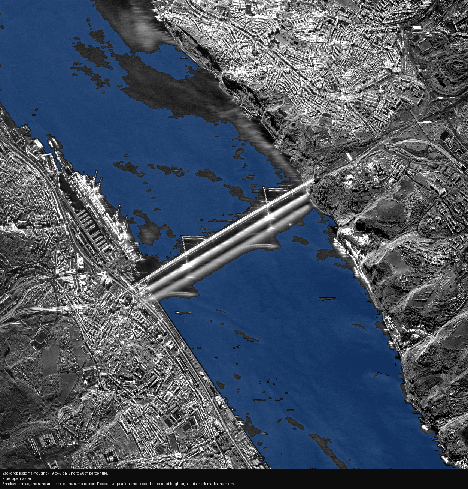
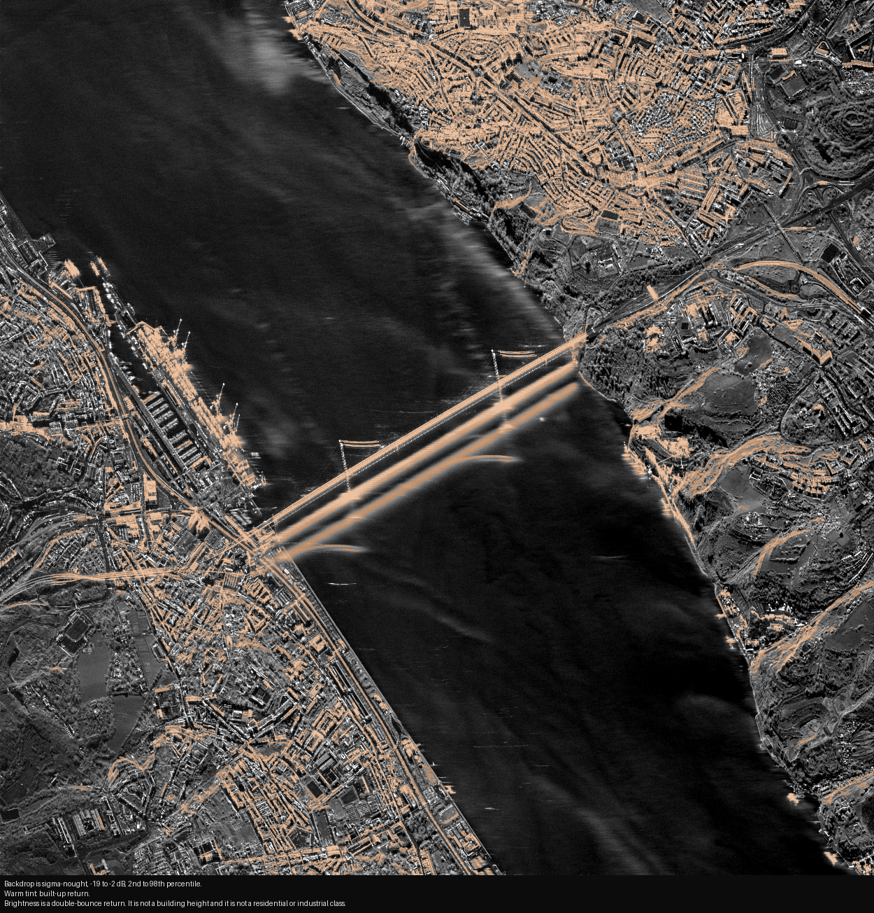
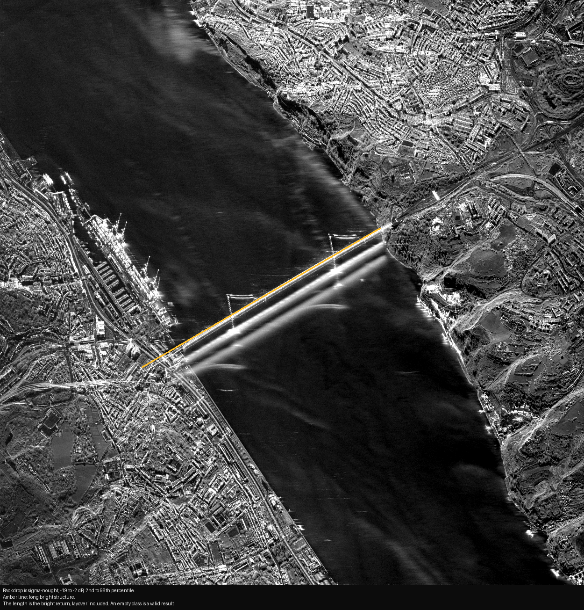
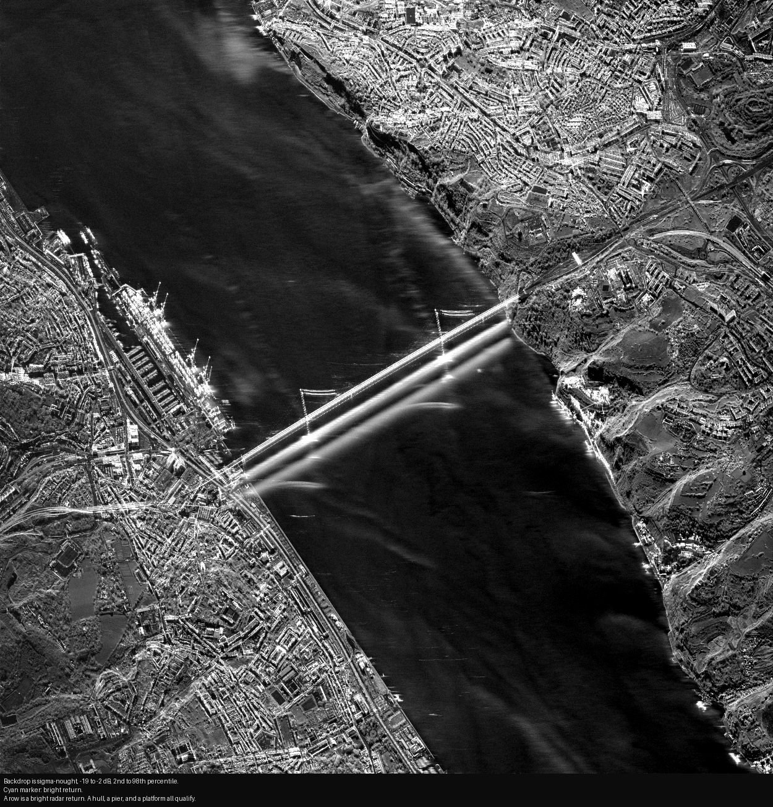
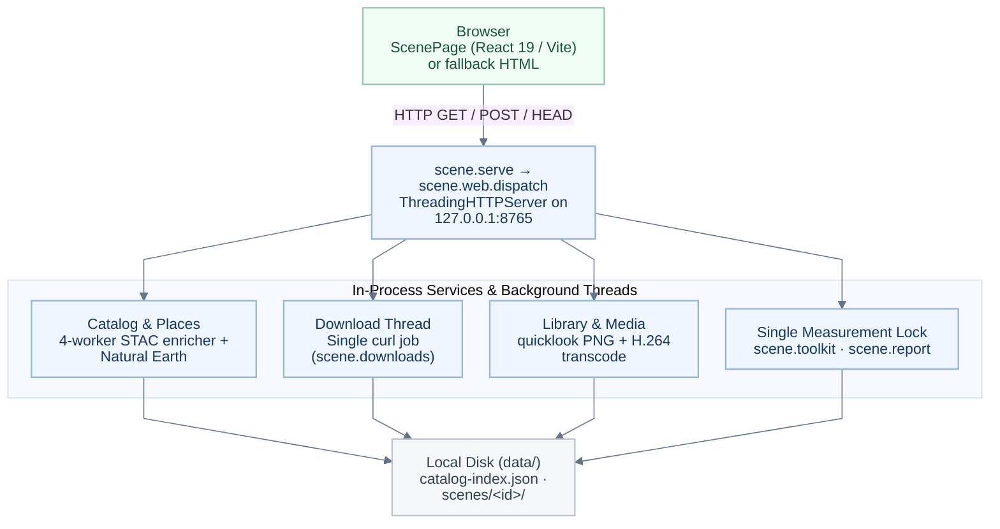

<a id="readme-top"></a>

<p align="center"></p>

<h1 align="center">SAR Toolkit</h1>

<p align="center">Explore the public ICEYE open-data STAC catalogue, stream scenes to disk, and run calibrated radar measurements that state only what the rasters support.</p>

<p align="center"><strong>A bright mark is a bright radar return.</strong></p>

<p align="center"><a href="#quick-start">🚀 Quick start</a> · <a href="#analysis-toolkit">🧰 Analysis toolkit</a> · <a href="#open-source-architecture">🏗️ Architecture</a> · <a href="#documentation-and-contributing">🧪 Development &amp; tests</a> · <a href="./docs/application.md">📚 Application reference</a> · <a href="./content/sar_glossary.md">📖 SAR glossary</a></p>

<p align="center">
  
  
  
  
  
</p>

<p align="center">
  
  
  
  
</p>

<details>
<summary>Table of contents</summary>

- [💡 What is SAR Toolkit?](#what-is-sar-toolkit)
  - [Core capabilities](#core-capabilities)
  - [Committed Lisbon showcase](#committed-lisbon-showcase)
- [🚀 Quick start and workflows](#what-you-can-build)
  - [Quick start: run with Docker Compose](#quick-start)
  - [Run locally from source](#local-setup)
  - [Configuration and optional OpenAI key](#configuration)
- [🧰 Analysis toolkit, reports, and careful claims](#analysis-toolkit)
  - [Toolkit measurements](#toolkit-measurements)
  - [Scene report, PDF export, Usage guide, and Guide chat](#scene-report-and-guide)
- [🏗️ Explore the architecture](#open-source-architecture)
  - [Single-process design and background workers](#single-process-design)
  - [On-disk layout and HTTP API](#on-disk-and-http)
- [📚 Development, testing, and repository layout](#documentation-and-contributing)
  - [Runtime requirements](#runtime-compatibility)
  - [Repository layout, checks, and troubleshooting](#developing-in-this-repository)
- [📖 References and documentation](#documentation-references)
- [📄 Status and license](#license)

</details>

<a id="what-is-sar-toolkit"></a>

## 💡 What is SAR Toolkit?

**SAR Toolkit** is a local synthetic-aperture radar (SAR) scene viewer and measurement workbench built around the public [ICEYE open-data STAC collection](https://iceye-open-data-catalog.s3.amazonaws.com/collections/iceye-sar.json) ([CC BY 4.0](https://creativecommons.org/licenses/by/4.0/)). There is no account, no commercial ICAS catalog integration, and no database — scenes live as folders on disk under `data/scenes/<scene-id>/`.

The application boots from one public collect: **`ICEYE_EYCKP5_20251024T135309Z_6724574_X52_SLF`** (ICEYE-X52, Spotlight, X-band, VV polarization, 24 October 2025 at 13:53 UTC), covering the **25 de Abril bridge** across the Tagus in Lisbon. Large radar rasters stay out of git; the repository ships a committed preview, thumbnail, dwell video, single-scene/dwell analysis results, and report under [`demo/lisbon/`](./demo/lisbon) so a fresh container start works immediately.

Every view and measurement enforces strict epistemic boundaries:

- **A bright mark is a bright radar return.** The viewer does not name a ship, match AIS, fuse another sensor, or claim that a model read the radar.
- **No model reads pixels.** When `OPENAI_API_KEY` is provided (optional), `gpt-6-luna` via LangChain only orders runnable tools, writes short progress lines, drafts a grounded report lead or section reading from `measurements.json` and [`content/sar_glossary.md`](./content/sar_glossary.md), or answers questions in Guide Chat. Every tool, report, and PDF works without a key.
- **Every result carries its limit.** Each generated PNG carries its legend, and each briefing and report section retains the tool's limit sentence explaining what the number is *not*.

<a id="core-capabilities"></a>

### Core capabilities

<div align="center" style="overflow-x: auto;">

<table align="center" style="display: table; width: auto; margin-left: auto; margin-right: auto;">
<thead>
<tr>
<th>Area</th>
<th>Capabilities</th>
</tr>
</thead>
<tbody>
<tr>
<td><strong>Preview &amp; Stage</strong></td>
<td>Quicklook PNGs rendered in product pixel orientation (≤1600 px long edge), local thumbnails, and byte-range dwell video playback (<code>vid-mp4</code>, automatically transcoded to cached H.264 via <code>ffmpeg</code> when encoded as <code>mp4v</code>).</td>
</tr>
<tr>
<td><strong>Catalog &amp; Downloads</strong></td>
<td>Search the static ICEYE open-data collection by scene ID, date range, satellite, product code, and bounding box. Background workers enrich footprints and asset sizes into a 24-hour cache (<code>data/catalog-index.json</code>) and label each row with the nearest Natural Earth place within 150 km (or <em>Open sea</em>). Resumable <code>curl</code> streaming keeps large data rasters unchecked by default.</td>
</tr>
<tr>
<td><strong>Library &amp; Demo Seed</strong></td>
<td>Scans <code>data/scenes/*/stac.json</code>, sorts the Lisbon test scene first, seeds an empty volume from <code>demo/lisbon/</code> (or a drawn placeholder if absent), and supports clearing placeholder files from the UI banner.</td>
</tr>
<tr>
<td><strong>Analysis Toolkit (15 tools)</strong></td>
<td>Coarse-overview sigma-nought (<code>calibration_factor * DN²</code>) and dwell/stack tools across <strong>Surface</strong>, <strong>Objects</strong>, <strong>Motion</strong>, <strong>Change</strong>, and <strong>Stack</strong>, with adaptive incidence/pixel-size controls, decibel PNGs, <code>measurements.json</code>, and <code>briefing.md</code>.</td>
</tr>
<tr>
<td><strong>Scene Report &amp; PDF</strong></td>
<td>One-click <strong>Start</strong> selects runnable tools in code, executes them sequentially on the measurement thread, stores incremental <code>report.json</code> updates, and exports an A4 document with WeasyPrint (<code>report.pdf</code>).</td>
</tr>
<tr>
<td><strong>Documentation &amp; Guide Chat</strong></td>
<td>Built-in non-analyst <strong>Documentation</strong> view quoting tool limits and the SAR glossary, paired with an <strong>Ask</strong> chat panel that routes relevant questions directly to matching guide sections.</td>
</tr>
</tbody>
</table>

</div>

<a id="committed-lisbon-showcase"></a>

### Committed Lisbon showcase

These outputs are committed in [`demo/lisbon/`](./demo/lisbon/scenes/ICEYE_EYCKP5_20251024T135309Z_6724574_X52_SLF) from running the current single-scene and dwell toolkit on the Lisbon collect (with no control overrides and no model key):

<div align="center" style="overflow-x: auto;">

<table align="center" style="display: table; width: auto; margin-left: auto; margin-right: auto;">
<tbody>
<tr>
  <td width="50%" align="center"><br /><strong>Preview quicklook</strong> · Product orientation, 25 de Abril bridge</td>
  <td width="50%" align="center"><br /><strong>Open water</strong> · Dark smooth water mask and median sigma-nought</td>
</tr>
<tr>
  <td width="50%" align="center"><br /><strong>Built-up return</strong> · Double-bounce clusters on land</td>
  <td width="50%" align="center"><br /><strong>Long structure</strong> · Waterline structure extent (layover included)</td>
</tr>
<tr>
  <td width="50%" align="center"><br /><strong>Returns on water</strong> · Compact bright returns (up to 24 brightest)</td>
  <td width="50%" align="center"><br /><strong>Dwell motion</strong> · Stationary (cyan) vs. moved (red) tracks</td>
</tr>
</tbody>
</table>

</div>

<p align="right"><a href="#readme-top"></a></p>

<a id="what-you-can-build"></a>

## 🚀 Quick start and workflows

<div align="center" style="overflow-x: auto;">

<table align="center" style="display: table; width: auto; margin-left: auto; margin-right: auto;">
<thead>
<tr>
<th>Your goal</th>
<th>How it works</th>
<th>Start here</th>
</tr>
</thead>
<tbody>
<tr>
<td><strong>Explore immediately in Docker</strong></td>
<td>Builds the React UI and Python server in one image, seeds <code>/app/data</code> from <code>demo/lisbon/</code>, and serves on port <code>8765</code>.</td>
<td><a href="#quick-start">Docker Compose</a></td>
</tr>
<tr>
<td><strong>Develop locally from source</strong></td>
<td>Run Python 3.12 and build <code>frontend/dist</code> with <code>pnpm</code> (Node 26.13.0). Download the preview pack or full rasters with <code>scene.fetch</code>.</td>
<td><a href="#local-setup">Local setup</a></td>
</tr>
<tr>
<td><strong>Run measurements on real rasters</strong></td>
<td>Check <code>grd-cog</code>, <code>grd-json</code> (and <code>vid-cog</code> for motion) in the Catalog dock or pass <code>--all</code> to <code>python -m scene.fetch</code>.</td>
<td><a href="#analysis-toolkit">Analysis toolkit</a></td>
</tr>
</tbody>
</table>

</div>

<a id="quick-start"></a>

### Quick start: run with Docker Compose

From a fresh clone:

```bash
docker compose up --build
```

Open **[http://127.0.0.1:8765](http://127.0.0.1:8765)**.

On first start, `demo/build_seed.py` seeds the `/app/data` Docker volume with the committed Lisbon preview (`preview.png`, `graphic.png`), dwell video (`vid-mp4.mp4`), single-scene/dwell analyses, and `report.json`. The image does **not** bake in a GRD (~484 MB), SLC (~11 GB), colorized sub-aperture image (~1.2 GB), dwell stack (~827 MB), or quicklook COG — download those from the **Catalog** pane when you want to re-run measurements locally.

- Reset the seeded volume at any time with `docker compose down -v`.
- The copied pack writes `demo.json` with `seeded` set. The header banner offers **Clear demo data**, which removes the preview, thumbnail, dwell video, analysis, and report, and leaves `stac.json`.
- If `demo/lisbon/` is removed, `scene.demo` falls back to a drawn gray placeholder labeled with `demo.json` (`placeholder` set). That banner uses the same **Clear demo data** button.

<a id="local-setup"></a>

### Run locally from source

Run commands from the repository root (the directory containing [`pyproject.toml`](./pyproject.toml)). Requires **Python 3.12**, **`pnpm`**, **`curl`**, **`ffmpeg`** (for H.264 dwell video playback), and **WeasyPrint** system libraries (`libpango-1.0-0`, `libpangoft2-1.0-0`, `libharfbuzz-subset0`, `fonts-liberation` for PDF export).

```bash
python3 -m venv .venv
.venv/bin/pip install -r requirements.txt
.venv/bin/pip install -e .
.venv/bin/python -m scene.fetch
pnpm --dir frontend install
pnpm --dir frontend build
.venv/bin/python -m scene.serve
```

Open **[http://127.0.0.1:8765](http://127.0.0.1:8765)**.

- `.venv/bin/python -m scene.fetch` downloads the Lisbon preview pack (`stac.json`, `graphic`, `qlk-cog`, `qlk-json`, `vid-mp4`). Add `--all` to stream the full rasters (`grd-cog`, `csi-cog`, `vid-cog`, `slc-cog`, and JSON sidecars). Files already matching remote size are skipped, and `curl` resumes partial transfers.
- Note that the preview pack omits `grd-json.json` and `grd-cog.tif`, so toolkit measurements stay locked until those are downloaded (either via `--all` or the **Catalog** checklist in the UI).
- **Do not use `pnpm dev`** for verifying the application: the Python server (`scene.serve`) serves the built static bundle from `frontend/dist/`. If `frontend/dist/index.html` is absent, `GET /` falls back to the original Python HTML page showing the quicklook, STAC fields, and [`content/scene_note.md`](./content/scene_note.md). The web interface measures with `scene.toolkit` and `scene.report`.

<a id="configuration"></a>

<details>
<summary>Configuration: environment variables and optional OpenAI key</summary>

| Variable | Default | Effect |
| --- | --- | --- |
| `SCENE_HOST` | `127.0.0.1` | Address `scene.serve` binds (`0.0.0.0` inside Docker). |
| `SCENE_PORT` | `8765` | Listening port (integer `1`–`65535`). |
| `OPENAI_API_KEY` | unset | Optional. Passed from the shell or a gitignored `.env` beside [`docker-compose.yml`](./docker-compose.yml). A blank value counts as unset and startup still succeeds. A non-blank value containing spaces or exceeding 512 characters fails startup before listening (without logging the value). Never baked into the Docker image. |

You can also enter an OpenAI key at runtime via the **Settings** modal in the header (`POST /api/report/key`). A key entered in the UI lives in process memory only, is never written to disk or echoed back, and is cleared when the process restarts. When an environment key is already present, the UI field remains hidden.

</details>

<p align="right"><a href="#readme-top"></a></p>

<a id="analysis-toolkit"></a>

## 🧰 Analysis toolkit, reports, and careful claims

<a id="toolkit-measurements"></a>

### Toolkit measurements

The tool column groups 15 measurements under **Surface**, **Objects**, **Motion**, **Change**, and **Stack**. Each tool reads a downsampled COG overview (≤1600 px long edge for GRD, ≤1200 px for dwell stack) and converts amplitude DN to calibrated sigma-nought in decibels (`calibration_factor * DN²` from `grd-json.json`).

- **Single-scene tools** require `grd-cog.tif` and a calibration factor, and run on **Spotlight** and **Stripmap** collects only (`Scan` and `Scan Wide` stay locked because they are not treated as radiometrically calibrated).
- **Dwell motion** additionally requires the georeferenced dwell stack `vid-cog.tif`.
- **Change & Stack tools** compare calibrated scenes that share the same look: **same orbit direction**, **same look side**, **incidence within 1°**, and **footprint overlap ≥ 30%** of the smaller footprint. **Stack mean** requires at least 5 matched scenes on disk; other stack tools require at least 2. (Change and stack remain locked for the Lisbon bridge scene because the public catalog has no second matching look.)
- **Adaptive sidebar controls:** Gate defaults near `1.5 dB` widen by `0.5 dB/deg` outside 26°–34° incidence; pixel windows scale to the nearest odd integer matching the ground length in metres for the scene's overview pixel size.

<div align="center" style="overflow-x: auto;">

<table align="center" style="display: table; width: auto; margin-left: auto; margin-right: auto;">
<thead>
<tr>
<th>Group</th>
<th>Tool</th>
<th>Measures &amp; controls</th>
<th>Built-in limit</th>
</tr>
</thead>
<tbody>
<tr>
<td><strong>Surface</strong></td>
<td><strong>Open water</strong></td>
<td>Dark smooth water from histogram mode (<code>water_gate_db</code>, <code>texture_window_px</code>, <code>max_hole_px</code>). Area, fraction, median σ⁰.</td>
<td>Shadow, tarmac, and sand are also dark; flooded vegetation/streets appear bright and are marked dry.</td>
</tr>
<tr>
<td><strong>Surface</strong></td>
<td><strong>Sea roughness</strong></td>
<td>Calm vs. wind-roughened water inside the water mask (<code>split_db</code>).</td>
<td>Roughness split only — not wave period, wave height, or current.</td>
</tr>
<tr>
<td><strong>Surface</strong></td>
<td><strong>Built-up return</strong></td>
<td>Bright clusters on land above water mode (<code>bright_offset_db</code>). Land fraction and cluster count.</td>
<td>Double-bounce return — not building height or land-use class.</td>
</tr>
<tr>
<td><strong>Objects</strong></td>
<td><strong>Returns on water</strong></td>
<td>Compact bright returns touching water (<code>bright_offset_db</code>, <code>min_area_m2</code>; ≥4 overview px, top 24 brightest).</td>
<td>Labeled bright return only — a hull, pier, and platform all qualify.</td>
</tr>
<tr>
<td><strong>Objects</strong></td>
<td><strong>Long structure</strong></td>
<td>Long bright return along the waterline (<code>band_m</code>, <code>bright_offset_db</code>, <code>min_length_m</code>; ≥40 overview px).</td>
<td>End-to-end extent including radar layover. Empty result is valid.</td>
</tr>
<tr>
<td><strong>Motion</strong></td>
<td><strong>Dwell motion</strong></td>
<td>Peak tracking across dwell frames (<code>search_radius_px</code>, <code>move_gate_m</code>; ≥4 overview px). Cyan = stationary, red = moved.</td>
<td>Displacement and speed over the collect seconds — not a route.</td>
</tr>
<tr>
<td><strong>Change</strong></td>
<td><strong>Amplitude change</strong></td>
<td>Two-date comparison (earlier = red, later = cyan, match = gray; <code>change_db</code> 3 dB, <code>support_px</code> 8 px).</td>
<td>Measures backscatter change; does not name a flood or a vessel.</td>
</tr>
<tr>
<td><strong>Stack</strong></td>
<td><strong>Water persistence</strong></td>
<td>Number of dates each pixel is water (<code>water_gate_db</code>).</td>
<td>Two dates are a pair, not a seasonal record.</td>
</tr>
<tr>
<td><strong>Stack</strong></td>
<td><strong>Sea state</strong></td>
<td>Median water σ⁰ per date (<code>water_gate_db</code>).</td>
<td>Lower bar is darker sea, not a Beaufort number.</td>
</tr>
<tr>
<td><strong>Stack</strong></td>
<td><strong>Dark sea anomaly</strong></td>
<td>Water darker than stack median surrounded by a brighter ring (<code>dark_db</code>, <code>support_px</code>, <code>ring_db</code>).</td>
<td>Extent only — could be biogenic film, wind shadow, rain, or current boundary.</td>
</tr>
<tr>
<td><strong>Stack</strong></td>
<td><strong>Shoreline</strong></td>
<td>Waterline contour per date (<code>width_px</code>).</td>
<td>A shift is a waterline, not a tide height.</td>
</tr>
<tr>
<td><strong>Stack</strong></td>
<td><strong>Date of change</strong></td>
<td>First date a pixel departs stack median (<code>change_db</code>, <code>support_px</code>).</td>
<td>Marks timing of ≥3 dB departure in ≥8 px patches only.</td>
</tr>
<tr>
<td><strong>Stack</strong></td>
<td><strong>Repeat returns</strong></td>
<td>Bright returns across many dates vs. single date (<code>match_m</code> ≥6 overview px).</td>
<td>Many dates can be a rock, pier, or moored hull; one date is a passing return.</td>
</tr>
<tr>
<td><strong>Stack</strong></td>
<td><strong>Site activity</strong></td>
<td>Bright clusters appearing or disappearing vs. stack median (<code>bright_offset_db</code>, <code>min_pixels</code>).</td>
<td>Cluster appearance/departure only — no cause assigned.</td>
</tr>
<tr>
<td><strong>Stack</strong></td>
<td><strong>Stack mean</strong></td>
<td>Multi-date mean across ≥5 matched dates (no controls).</td>
<td>Cuts speckle on stable surfaces; changed surfaces blur rather than disappear.</td>
</tr>
</tbody>
</table>

</div>

<a id="scene-report-and-guide"></a>

<details>
<summary>Scene report, PDF export, Usage guide, and Guide chat</summary>

### Scene report (`report.json` &amp; `report.pdf`)

Choosing **Report** in the Scene column opens the report view. Choosing **Start** runs all eligible tools for the open scene (or, when an eligible Amplitude change partner is selected, single/motion tools + that partner's Amplitude change + all Stack tools across every matched date):

1. **Deterministic tool selection:** Code chooses which tools are included and which remain `locked` sections.
2. **Optional `gpt-6-luna` calls (when `OPENAI_API_KEY` is set):**
   - **Order** (temp `0`): proposes an execution permutation of runnable tool IDs (falls back to catalog order if invalid).
   - **Narrator** (temp `0.7`): writes 1–2 humorous progress sentences while a tool runs (falls back to a plain status sentence).
   - **Section reading** (temp `0`): after a `done` section saves, optionally writes `reading_md`. Replies mentioning `"ship"`, `"spill"`, `"tide height"`, or `"building height"`, or omitting the tool's limit sentence, are rejected and `briefing_md` stays unchanged.
   - **Synthesis** (temp `0`): drafts the report lead from summary rows, limits, failures, locks, and [`content/sar_glossary.md`](./content/sar_glossary.md). Single-scene runs discard leads that invent a stack or second date and fall back to the deterministic toolkit lead.
3. **WeasyPrint PDF:** `GET /api/scenes/<id>/report.pdf` renders the saved `report.json` as an A4 HTML/CSS document with page breaks, inline summaries, overview PNGs, and limit sentences — with no model call.

### Usage guide &amp; Guide chat

- **Documentation** (`GET /api/guide`) renders plain-language help covering the viewer, catalog search, each toolkit tool's input file and limit sentence, SAR glossary terms, and non-running retrieval/Kubernetes sketches.
- **Ask** (`POST /api/guide/chat`) opens **Guide chat** at the bottom right. Questions outside the viewer or SAR are refused without calling a model; questions matching a guide section offer a one-click jump into **Documentation**. Without an OpenAI key, the chat prompts for a key in Settings while still offering matching section links.

</details>

<p align="right"><a href="#readme-top"></a></p>

<a id="open-source-architecture"></a>

## 🏗️ Explore the architecture

<a id="single-process-design"></a>

### Single-process design and background workers

One Python `ThreadingHTTPServer` process serves both the static Vite/React 19 UI (`frontend/dist/`, built with Tailwind 4, Base UI, and Lucide icons) and the JSON/media API. Long-running work executes on dedicated background threads inside that process, with no external database or message queue:



- **Shared measurement lock:** Toolkit runs and report generation share one measurement thread and return `409 {"status": "running"}` if a second measurement is requested concurrently.
- **Single download lock:** Only one download runs at a time; progress reflects bytes written by `curl` on disk.
- **Client error logging:** Browser `error` and `unhandledrejection` events post to `POST /client-error` and are logged on the server.
- **Safety boundaries:** Scene IDs are validated against `[A-Za-z0-9_-]+`; the server never serves `data/` by arbitrary caller paths, and catalog thumbnails are proxied only from allowlisted `iceye-open-data-catalog` S3 hosts.

<a id="on-disk-and-http"></a>

<details>
<summary>On-disk scene structure and HTTP API routes</summary>

### On disk (`data/`)

```text
data/
├── catalog-index.json                 24-hour cached catalog metadata
└── scenes/
    └── <scene-id>/
        ├── stac.json                  STAC item record
        ├── {asset-key}{suffix}        e.g. qlk-cog.tif, graphic.png, grd-cog.tif, grd-json.json, vid-mp4.mp4, vid-cog.tif
        ├── vid-mp4.mp4.avc.mp4        Cached H.264 copy when product video is mp4v
        ├── analysis/<tool-id>/        overview.png, measurements.json, briefing.md
        │   └── <partner-id>/          Partner subdirectory for amplitude-change only
        └── report/report.json         Saved report state, sections, and synthesis
```

### HTTP routes

| Route | Purpose |
| --- | --- |
| `GET /` | Serves `frontend/dist/index.html` (`no-store`), or fallback `scene.page` HTML when the React build is absent. |
| `GET /api/library` | Lists valid scenes on disk under `data/scenes/*/stac.json` with Natural Earth place labels. |
| `GET /api/scenes/<id>` | Scene metadata and asset status. |
| `GET /api/scenes/<id>/quicklook.png` | Renders `qlk-cog.tif` (≤1600 px, cached by mtime), or serves `preview.png` / `graphic` when absent. |
| `GET /api/scenes/<id>/thumbnail` | Local `graphic` file. |
| `GET /api/scenes/<id>/video` | Dwell video (`video/mp4`) with `Accept-Ranges: bytes` (`206` slices), transcoding `mp4v` to H.264 on demand. |
| `GET /api/scenes/<id>/tools` | All 15 toolkit tools with lock reasons, eligible partners, saved results, and scene-suggested `controls`. |
| `GET /api/scenes/<id>/analysis/<tool>/overview.png` | Rendered toolkit overview PNG (inserts `/<partner>` for `amplitude-change`). |
| `POST /api/jobs/run`, `GET /api/jobs/current` | Start a toolkit run, or poll current measurement status. |
| `POST /api/scenes/<id>/report/run`, `GET .../report`, `GET .../report.pdf` | Start a report job, poll incremental `report.json`, or download the WeasyPrint A4 PDF. |
| `GET /api/report/key`, `POST /api/report/key` | Inspect key source (`unset`, `environment`, `session`) or set an in-memory key for the running process. |
| `GET /api/catalog/search`, `POST /api/catalog/refresh`, `GET /api/catalog/items/<id>`, `GET .../thumbnail` | Search cached catalog (`limit` 1–100, default 24), clear cache, inspect item sizes, or proxy thumbnails. |
| `POST /api/downloads`, `GET /api/downloads/current` | Start a resumable download (`assets` omitted = preview pack) or poll per-file byte counts. |
| `POST /api/demo/clear` | Clears placeholder pictures, `analysis/`, and `demo.json` while keeping `stac.json`. |
| `GET /api/guide`, `POST /api/guide/chat` | Load Documentation sections or run one grounded Guide Chat turn. |
| `POST /client-error` | Logs browser runtime errors to the server log (`204`). |

</details>

<p align="right"><a href="#readme-top"></a></p>

<a id="documentation-and-contributing"></a>

## 📚 Development, testing, and repository layout

<a id="runtime-compatibility"></a>

### Runtime requirements

<div align="center" style="overflow-x: auto;">

<table align="center" style="display: table; width: auto; margin-left: auto; margin-right: auto;">
<thead>
<tr>
<th>Component</th>
<th>Requirement</th>
<th>Notes</th>
</tr>
</thead>
<tbody>
<tr>
<td><strong>Python</strong></td>
<td><code>3.12</code></td>
<td>Core runtime deps: <code>numpy</code>, <code>pillow</code>, <code>scipy</code>, <code>tifffile</code>, <code>imagecodecs</code>, <code>langchain-core</code>, <code>langchain-openai</code>, <code>weasyprint</code>.</td>
</tr>
<tr>
<td><strong>Node.js &amp; pnpm</strong></td>
<td>Node <code>26.13.0</code> (<code>&gt;=26.13.0 &lt;27</code>) · <code>pnpm</code></td>
<td>Pinned via <a href="./frontend/.nvmrc"><code>frontend/.nvmrc</code></a>. Use <code>pnpm</code> exclusively (never <code>npm</code>).</td>
</tr>
<tr>
<td><strong>System tools</strong></td>
<td><code>curl</code>, <code>ffmpeg</code>, Pango, HarfBuzz subset, Liberation font</td>
<td>Required for asset streaming, <code>mp4v</code>→H.264 video transcoding, and WeasyPrint PDF rendering (installed automatically in <a href="./Dockerfile"><code>Dockerfile</code></a>).</td>
</tr>
</tbody>
</table>

</div>

<a id="developing-in-this-repository"></a>

<details>
<summary>Repository layout, test / lint commands, and troubleshooting</summary>

### Repository layout

```text
.
├── src/scene/          Python server, STAC loader, catalog, downloader, toolkit, report, guide, fallback page
├── frontend/           React 19 + Vite + Tailwind 4 + Base UI source (builds to frontend/dist/)
├── demo/               Committed Lisbon showcase (demo/lisbon/) and image seed builder (demo/build_seed.py)
├── content/            Person-written scene note (scene_note.md) and allowed SAR wording (sar_glossary.md)
├── tests/              Python unittest suite
├── docs/               Application specification and planned work (docs/application.md)
├── Dockerfile          Multi-stage Node 26.13.0 + Python 3.12 image
└── docker-compose.yml  Single-service compose definition publishing port 8765
```

### Tests, typechecking, and linting

```bash
# Python dev setup & checks
.venv/bin/pip install -r requirements-dev.txt
.venv/bin/pip install -e .
.venv/bin/python -m unittest discover -s tests
.venv/bin/ruff check .
.venv/bin/mypy

# Frontend checks (Jest unit tests; no Cypress suite in this repository)
pnpm --dir frontend typecheck
pnpm --dir frontend lint
pnpm --dir frontend test
pnpm --dir frontend build
```

- Ruff enforces `E`, `F`, `I`, and `UP` at line length `88`.
- `mypy` runs in `strict` mode on `src/scene` and `tests`.
- Python PDF tests mock the WeasyPrint writer, so running the test suite locally does not require Pango/Cairo unless generating real PDFs.

### Troubleshooting

- **`No module named scene` or syntax errors on type annotations:** Run `.venv/bin/python` from the repository root rather than a system `python`.
- **Plain Python layout instead of the React app:** `frontend/dist/index.html` is missing — run `pnpm --dir frontend build`.
- **Dwell video plays, but Dwell motion stays locked:** Stage playback uses `vid-mp4`; Dwell motion requires the georeferenced stack `vid-cog.tif`.
- **Tool starts and fails on sidecar:** The Lisbon scene can pass the calibration lock via a hardcoded factor, but overview pixel spacing still requires `grd-json.json` (`proj:transform`).
- **Catalog bbox search returns empty while indexing:** Check `unread_for_bbox` — footprints populate lazily via background workers into `data/catalog-index.json`.

</details>

<p align="right"><a href="#readme-top"></a></p>

<a id="documentation-references"></a>

## 📖 References and documentation

- **[docs/application.md](./docs/application.md)** — Authoritative specification for features, HTTP contracts, careful-claim rules, and planned work.
- **[content/sar_glossary.md](./content/sar_glossary.md)** — Allowed SAR terminology and canonical toolkit limit sentences.
- **[content/scene_note.md](./content/scene_note.md)** — Human-written note for the Lisbon 25 de Abril bridge scene (shown on the fallback page and quoted by the usage guide).
- **[ICEYE Open Data Initiative](https://www.iceye.com/open-data-initiative)** — Public STAC catalogue source.

<p align="right"><a href="#readme-top"></a></p>

<a id="license"></a>

## 📄 Status and license

- **Version:** `0.1.0`
- **Data &amp; catalogue:** Scenes and STAC metadata originate from the [ICEYE open data catalogue](https://www.iceye.com/open-data-initiative) under [CC BY 4.0](https://creativecommons.org/licenses/by/4.0/). Place labels in `src/scene/places.json` derive from Natural Earth.
- **Code:** No code license is declared in this repository.

<p align="right"><a href="#readme-top"></a></p>
